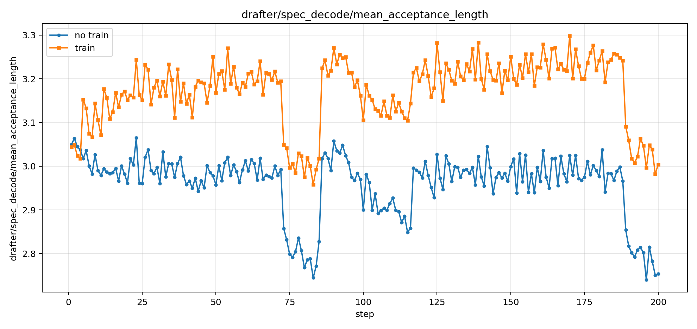
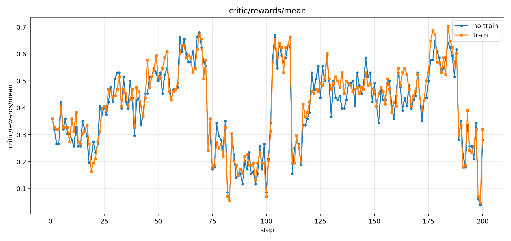
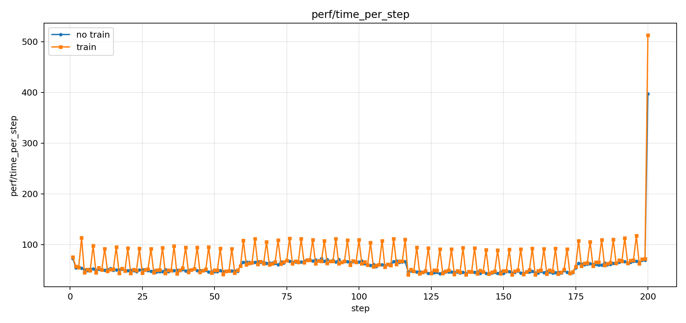
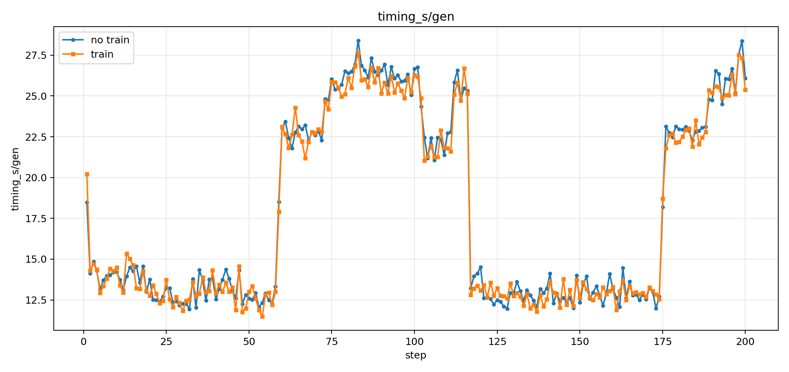
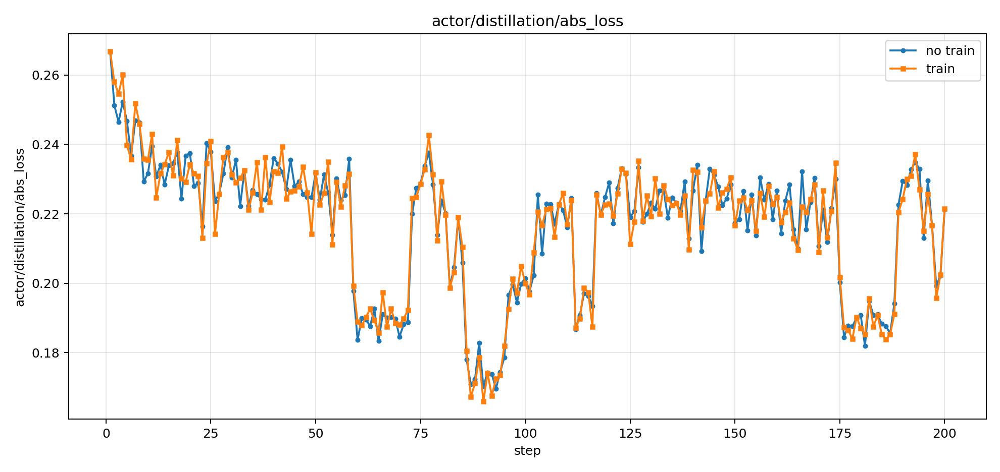
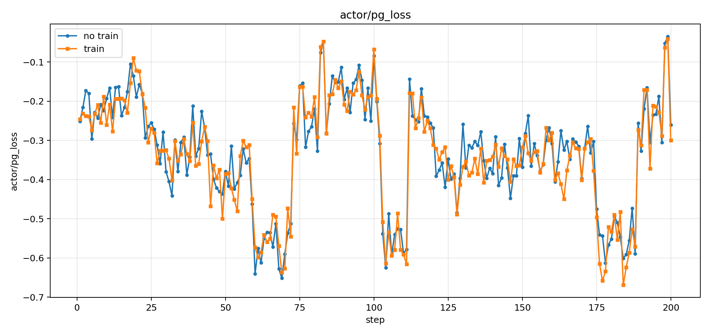

# Synchronous OPD co-training: DSpark comparison

Last updated: October 14, 2026.

This experiment compares OPD with a fixed DSpark drafter against OPD with online DSpark drafter co-training over training steps 1–200. Both runs update the student through OPD; the comparison switches online drafter training off or on.

## Setup

| Setting | Value |
| --- | --- |
| Student | Qwen3-8B |
| Teacher | Qwen3-32B |
| Data | GSM8K and MATH |
| Student backend | FSDP2 |
| Rollout and teacher inference | vLLM |
| GPU allocation | 4 student training/rollout GPUs and 2 teacher GPUs |
| Training batch / mini-batch | 128 / 128 |
| Prompt / response limit | 1,024 / 2,048 tokens |
| Student learning rate | 1e-6 |
| Distillation | k1, top-k 64, policy gradient enabled |
| Drafter | DSpark, block size 4 |
| Drafter learning rate | 6e-6 |
| Drafter collection / training / publication interval | Every 4 student steps |
| Drafter updates per scheduled training call | 20 |
| Drafter publication | Synchronous |

The console logs contain the resolved command and configuration. The experiment name in the original scripts contains `qwen3_4b`; the resolved model path in both logs is `Qwen3-8B`.

## Results

Values are arithmetic means of the logged per-step metrics for steps 1–200, with 200 observations per metric except the fixed-drafter training timer, which is absent.

Both logs record step 200 and then report a killed DataLoader worker during shutdown. The co-training log also records a segmentation fault in the Ray/OpenCensus process after the final step.

| Metric | Fixed drafter | Online co-training |
| --- | ---: | ---: |
| Mean acceptance length | 2.959672 | 3.170638 |
| Training reward mean | 0.407344 | 0.415156 |
| Time per step (s) | 56.363171 | 67.794074 |
| Generation time (s) | 17.887778 | 17.712187 |
| Drafter training time (s) | Not logged | 7.030057 |
| Actor distillation absolute loss | 0.216656 | 0.216678 |
| Actor policy-gradient loss | -0.331649 | -0.337015 |

Online drafter co-training increases mean acceptance length by 7.13% and training reward by 0.0078125. Mean generation time decreases by 0.98%; mean total step time increases by 20.28%, including the online drafter training and publication work. These figures describe the two supplied runs, using training reward rather than held-out evaluation accuracy.

## Plots













## Run artifacts and reproduction

- [Fixed-drafter launch script](run_opd_cotrain_dspark_vllm_fsdp2_no_training.sh)
- [Co-training launch script](run_opd_cotrain_dspark_vllm_fsdp2.sh)
- [Fixed-drafter console log](run_opd_cotrain_dspark_vllm_fsdp2_no_training.log.txt)
- [Co-training console log](run_opd_cotrain_dspark_vllm_fsdp2.log.txt)
- [Machine-readable averages and observation counts](summary.json)
- [SHA-256 checksums for the supplied plots, scripts, and logs](sha256.json)

The plots, scripts, and console logs are copied byte-for-byte from the supplied `20261013_005359` result directory. Log filenames use `.log.txt` so the snapshots can be tracked alongside the report. `summary.json` is recomputed from the logs and replaces the original comparison text with English field names; an absent timer is represented as `null` with zero observations.

To reproduce training, adapt the scripts' working directory and dataset paths, and set `STUDENT_MODEL`, `TEACHER_MODEL`, and `DRAFTER_MODEL` to local checkpoints. Keep the recorded settings for the fixed-drafter and co-training comparison.

To recompute the report data:

```bash
uv run python docs/experiments/opd-cotrain/20261013_005359/summarize_results.py
```

The added student-decode and teacher-prefill timing metrics are validated separately by runtime tests. The supplied experiment logs report the existing aggregate `timing_s/gen` timer.
